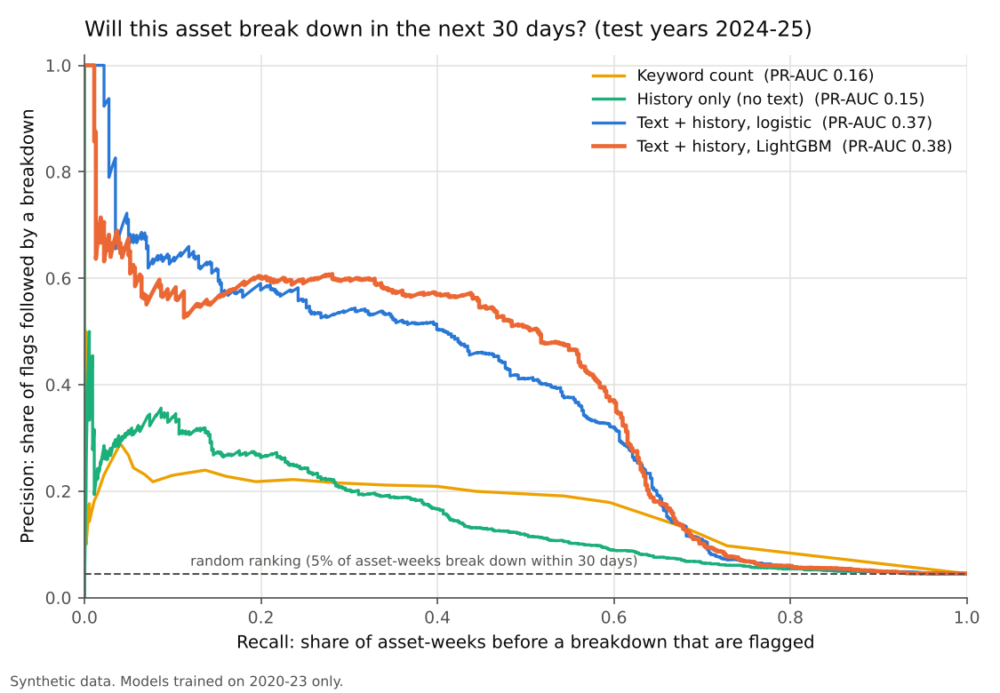
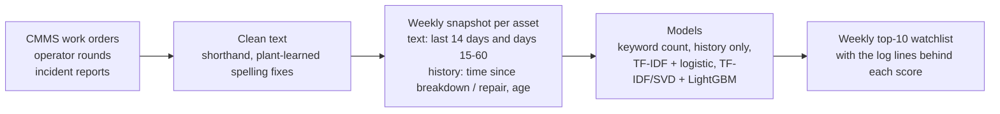

# Maintenance-log NLP for predictive maintenance

**Read the free-text remarks in work orders, operator rounds and incident reports, and give the maintenance planner a weekly list of the assets most likely to break down in the next 30 days, with the log lines that put each one there.**




## Problem statement

Most plants have no vibration or condition-monitoring sensor on most of their pumps, motors, valves and transmitters. But the early warnings are often already written down, in remarks like "brg temp rising", "seal weeping" or "valve hunting", spread across thousands of rounds and work orders that nobody reads together. An unplanned breakdown costs lost production, emergency repair rates and sometimes a process upset or a trip. If those remarks are read every week and ranked, a planned repair can replace a breakdown.

## Features

- Cleans field shorthand (`brg`, `vib`, `lkg`) and repairs typos using spelling **learned from the plant's own text**
- Builds a weekly snapshot per asset: last-14-day text, days 15–60 text, and maintenance history
- Compares four rankers side by side: a keyword count, history only, text + logistic regression, and text + LightGBM
- Produces a weekly top-10 watchlist, showing the log lines that drove each asset's score
- Reports plant-level measures: breakdowns caught, days of warning, and false alarms that were really repaired degradations
- Includes a FastAPI `/risk` endpoint that scores one asset from its recent log entries

## Tech stack

| Tool | Used for | Why this one |
|---|---|---|
| Python, pandas | Data handling, weekly snapshots | Standard and readable |
| scikit-learn | TF-IDF, SVD, logistic regression, metrics | The logistic model's coefficients can be read term by term, which explains the scores |
| LightGBM | Main ranker | Learns interactions such as "warning words, but a repair since" on mixed text and history features |
| Matplotlib | Figures | |
| FastAPI | `/risk` endpoint | The course's deployment step: lightweight, with interactive docs |
| pytest, GitHub Actions | Leakage, cleaning and API tests on every push | Leakage is the classic failure of time-series ML, so it is tested directly |

## Approach



| Stage | Where | Technique | Why this one |
|---|---|---|---|
| Data / cleaning | `src/data/` | Shorthand dictionary; spelling fixes learned from the training years only (a rare word one swapped letter pair away from a common word, e.g. `claened` → `cleaned`) | Without this, the model latched onto repeated typos as "signals". Learning from the local text respects plant vocabulary |
| Features | `src/features/` | Every asset, every week: text from the last 14 days and from days 15–60 kept apart, plus time since last breakdown and last repair, breakdowns in the last year, age, type. TF-IDF word pairs are built **inside one log entry only** | "Rising" this fortnight should count for more. In the first version, pairs spanning two entries ("completed painting") produced nonsense features |
| Models | `src/models/` | (1) keyword count, the spreadsheet-filter baseline; (2) history only; (3) TF-IDF + class-balanced logistic regression; (4) TF-IDF → SVD + LightGBM | The two baselines show what the text adds |
| Model choice | `src/pipeline.py` | Chosen on a validation year (2023), retrained on 2020–23, tested once on 2024–25 | The test years play no part in choosing the model |
| Watchlist | `src/watchlist/` | Top-10 per week; evidence lines ranked by the logistic model's term weights | The planner sees *why* each asset is on the list |
| Deployment | `src/api/` | FastAPI `/risk` | Score one asset from its recent entries |

## Project structure

```
maintenance-log-nlp-pdm/
├── data/
│   ├── raw/             synthetic asset register and maintenance log; ground_truth/ for evaluation only
│   ├── processed/       test-period scores, breakdowns caught
│   └── sample/          200 log entries for a quick look
├── models/              saved ranker bundle (LightGBM + logistic explainer + spelling fixes) + model card
├── notebooks/           01_walkthrough.ipynb: every stage with outputs
├── reports/             metrics.json, watchlist_latest_week.csv, figures/
├── src/
│   ├── api/             FastAPI service
│   ├── data/            generate_synthetic, load_data, preprocess
│   ├── features/        snapshots
│   ├── models/          rankers, evaluate, train
│   ├── watchlist/       weekly top-10 with evidence
│   ├── utils/           paths, plots
│   └── pipeline.py      stages wired together
├── tests/               leakage, cleaning, tokenising, split and API tests
├── .github/workflows/   CI: tests + full pipeline on every push
├── requirements.txt
├── README.md
└── main.py              runs every stage
```

## How it was validated

The data is synthetic, generated from a hidden degradation process, so the truth is known for every asset and every week: which breakdowns had warning signs in the text, which were sudden, and which degradations were caught and repaired.

1. **Time-based split with no label overlap.** Training on 2020–22, model choice on 2023, final test on 2024–25. Snapshots whose 30-day label window crosses a boundary are dropped. Unit tests check that a snapshot never sees text from its own day or later.
2. **Two baselines,** so the text model has to beat a keyword count and a no-text history model.
3. **Plant-level measures, not just ML scores:** how many test-year breakdowns were on the weekly top-10 list in the 30 days before, and how many days ahead.
4. **The learned terms were inspected.** That is how the cross-entry word-pair bug and the typo features were found and fixed.
5. **False alarms read against the ground truth:** how many flags pointed at a real degradation that maintenance then repaired.
6. **Five synthetic plants (seeds),** so the result is not one lucky draw: `python main.py --robustness`.

## Results

120 assets (pumps, compressors, motors, control valves, transmitters), 19,780 log entries over 6 years, 36,120 asset-weeks. Test years 2024–25.

| Measure (test years) | Keyword count | History only | Text + logistic | **Text + LightGBM** (chosen) |
|---|---|---|---|---|
| PR-AUC (random = 0.045) | 0.16 | 0.15 | 0.37 | **0.38** |
| Weekly top-10 list: share followed by a breakdown within 30 days | 20% | 18% | 30% | **33%** (7× random) |
| Breakdowns with warning signs in the text, flagged in the 30 days before | 73 of 97 | 69 of 97 | 92 of 97 | **93 of 97** |
| Sudden breakdowns (no warning in the text) flagged | 5 of 34 | 8 of 34 | 7 of 34 | 10 of 34 |
| Median warning before breakdown | 15 days | 17 days | 23 days | **24 days** |

Across five synthetic plants, text + LightGBM scores PR-AUC 0.37–0.42, against 0.12–0.15 for the keyword count. It flags 91–97% of the breakdowns that had warning signs in the text, with a median 22–24 days' warning.

**In plant terms:**
- About a third of the weekly watchlist breaks down within 30 days. Of the rest, 32% sat inside a real degradation that maintenance then repaired, which in a plant are the flags that worked.
- Sudden failures with nothing written beforehand can't be predicted from text. This adds to condition monitoring rather than replacing it.

**Terms the logistic model weighs** (readable, and checked): warning terms include *temperature, increasing, bearing, leak increasing, trending, discharge, bad (PV)*. Reassuring terms include *breakdown, corrective, replaced, overhauled* (a just-repaired asset is unlikely to fail again within the month) and *slightly high* (those remarks were usually rechecked as normal).


For the latest week, `reports/watchlist_latest_week.csv` lists the top 10 assets with the log lines behind each score. On the sample data, 7 of those 10 broke down within 30 days.

## What makes it different

- **It is measured the way a planner would judge it:** breakdowns caught and days of warning, not just an ML score. False alarms are checked against repairs that actually happened.
- **It shows its evidence.** Each watchlisted asset comes with the log lines that put it there.
- **It respects time.** Model choice and spelling fixes use only earlier years, and leakage is tested in code.

## How to run

```bash
python -m venv .venv && source .venv/bin/activate
pip install -r requirements.txt
python main.py                          # all stages, about 30 s
pytest                                  # unit and API tests
uvicorn src.api.app:app --reload        # API; open http://127.0.0.1:8000/docs
```

`python main.py --regenerate --seed 7` builds a different synthetic plant, and `python main.py --robustness` repeats the whole run on five plants. The notebook `notebooks/01_walkthrough.ipynb` shows every stage with its outputs.

## What I learned

- **Read what the model learned before trusting its score.** The two worst bugs (word pairs spanning log entries, typos acting as features) both showed up in the top-terms list, not in the metrics.
- **Text adds most where the history is silent.** History alone did no better than a keyword count. The gain came from the remarks.
- **A "false alarm" is not always false.** A third of them were real degradations that maintenance fixed. Only ground truth on repairs revealed that, and it changes how a planner should read the list.

## Data note

**All data in this repository is synthetic**, generated by `src/data/generate_synthetic.py`. Asset tags, units, dates and every log line are invented. No employer data, CMMS extracts, work orders, incident reports or plant names were used.

This is a public re-implementation of a personal prototype built on sample data. It has not been deployed at any plant. Real logs are messier than any generator, so the model would need to be retrained and re-checked on the plant's own history before use.

## Credits

Built with Claude Code; design, requirements and validation by Raja (Rajayoganandha Sekaran).

Licence: MIT.
