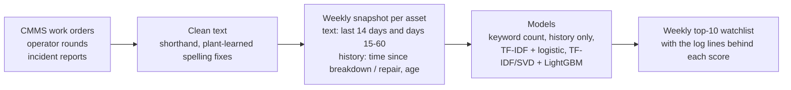
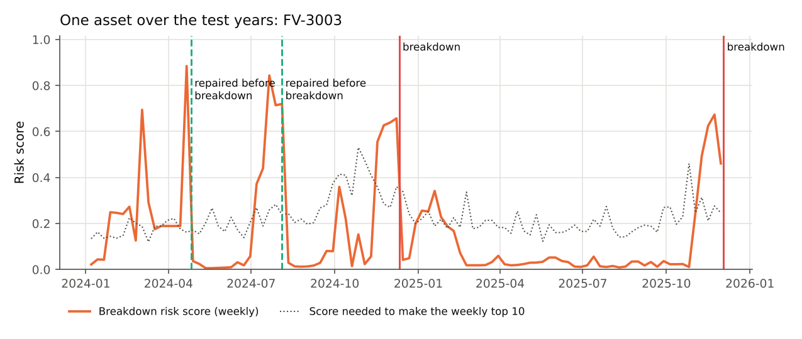

# Maintenance-log NLP for predictive maintenance

**Read the free-text remarks in work orders, operator rounds and incident reports, and give the maintenance planner a weekly list of the assets most likely to break down in the next 30 days, with the log lines that put each one there.**


## Why it matters

Most plants have no vibration or condition-monitoring sensor on most of their pumps, motors, valves and transmitters. But the early warnings are often already written down, in remarks like "brg temp rising", "seal weeping" or "valve hunting", spread across thousands of rounds and work orders that nobody reads together. An unplanned breakdown costs lost production, emergency repair rates and sometimes a process upset or a trip. If those remarks are read every week and ranked, a planned repair can replace a breakdown.

## Approach



| Step | Technique | Why this one |
|---|---|---|
| Cleaning | Shorthand dictionary (`brg` → bearing, `vib` → vibration); spelling fixes **learned from the plant's own text** (a rare word one swapped letter pair away from a common word, e.g. `claened` → `cleaned`), learned from the training years only | Without it the model latched onto repeated typos as "signals". Learning from the local text respects plant vocabulary instead of a generic dictionary. |
| Snapshot | Every asset, every week: text from the last 14 days and from days 15–60 kept separate, plus time since last breakdown and last corrective repair, breakdowns in the last year, age, asset type | Separating recent from older text lets "rising" or "increasing" this fortnight count for more. Only text dated before the snapshot day is used. |
| Text features | TF-IDF of words and word pairs, with pairs built **inside one log entry only** | Pairs across entries ("PM completed" + "painting done" → "completed painting") produced nonsense features in the first version. |
| Models | (1) keyword count, the spreadsheet-filter baseline; (2) history only, no text; (3) TF-IDF + class-balanced logistic regression; (4) TF-IDF compressed with SVD + LightGBM | The two baselines show what the text adds. Logistic regression is readable term by term. LightGBM can learn interactions such as "warning words, but a corrective work order since". |
| Model choice | Chosen on a validation year (2023) only, then retrained on 2020–23 and tested once on 2024–25 | The test years play no part in choosing the model. |

## How it was validated

The data is synthetic, generated from a hidden degradation process, so the truth is known for every asset and every week: which breakdowns had warning signs in the text, which were sudden, and which degradations were caught and repaired.

1. **Time-based split with no label overlap.** The model trains on 2020–22, the model choice is made on 2023, and the final test is 2024–25. Snapshots whose 30-day label window crosses a boundary are dropped. Unit tests check that a snapshot never sees text from its own day or later.
2. **Two baselines,** so the text model has to beat a keyword count and a no-text history model.
3. **Plant-level measures, not only ML scores:** of the breakdowns in the test years, how many were on the weekly top-10 list in the 30 days before, and how many days ahead.
4. **Inspected the learned terms.** That is how the cross-entry word-pair bug and the typo features were found and fixed (both described above).
5. **Read the false alarms against the ground truth:** how many flags pointed at a real degradation that maintenance then repaired.
6. **Five synthetic plants (seeds),** so the result is not one lucky draw: `python scripts/robustness.py`.

## Results on the sample data

120 assets (pumps, compressors, motors, control valves, transmitters), 19,780 log entries over 6 years, 36,120 asset-weeks. Test years 2024–25.

| Measure (test years) | Keyword count | History only | Text + logistic | **Text + LightGBM** (chosen) |
|---|---|---|---|---|
| PR-AUC (random = 0.045) | 0.16 | 0.15 | 0.37 | **0.38** |
| Weekly top-10 list: share followed by a breakdown within 30 days | 20% | 18% | 30% | **33%** (7× random) |
| Breakdowns with warning signs in the text, flagged in the 30 days before | 73 of 97 | 69 of 97 | 92 of 97 | **93 of 97** |
| Sudden breakdowns (no warning in the text) flagged | 5 of 34 | 8 of 34 | 7 of 34 | 10 of 34 |
| Median warning before breakdown | 15 days | 17 days | 23 days | **24 days** |

Across five synthetic plants, text + LightGBM scores PR-AUC 0.37–0.42 against 0.12–0.15 for the keyword count. It flags 91–97% of the breakdowns that had warning signs in the text, with a median of 22–24 days' warning.

**What the numbers mean in plant terms:**
- About a third of the weekly watchlist breaks down within 30 days. Of the rest, 32% sat inside a real degradation that maintenance then repaired. In a plant, those are the flags that worked.
- Sudden failures with nothing written beforehand are not predictable from text. The 10 of 34 caught are mostly assets with a recent breakdown history. Text analytics supplements condition monitoring; it does not replace it.

**Terms the logistic model learned to weigh** (readable, and checked): warning terms include *temperature, increasing, bearing, leak increasing, trending, discharge, bad (PV)*. Reassuring terms include *breakdown, corrective, replaced, overhauled*, because a just-repaired asset is unlikely to fail again within the month, and *slightly high*, because those remarks were usually rechecked as normal.



For the latest week, `outputs/watchlist_latest_week.csv` lists the top 10 assets with the log lines that drove each score. On the sample data, 7 of those 10 broke down within 30 days.

## How to run

```bash
python -m venv .venv && source .venv/bin/activate
pip install -r requirements.txt
python data/generate_synthetic.py     # optional: the sample data is already in data/
python run.py                         # snapshots, models, metrics, watchlist, figures (about 20 s)
pytest                                # unit tests
```

## Repository layout

```
data/generate_synthetic.py   synthetic asset register, maintenance log, hidden ground truth
data/ground_truth/           degradation episodes and breakdown modes (used only for evaluation)
src/pdm_nlp/                 features (cleaning, snapshots), models, pipeline, figures
tests/                       leakage, cleaning, tokenising and split tests
outputs/                     metrics.json, watchlist, per-breakdown results, test scores
docs/                        figures
```

## Data note

**All data in this repository is synthetic**, generated by `data/generate_synthetic.py`. Asset tags, units, dates and every log line are invented. No employer data, CMMS extracts, work orders, incident reports or plant names were used. A public maintenance-log dataset such as MaintNet could be swapped in for the text, but it has no matching breakdown labels, so the synthetic generator is used here to keep the evaluation exact.

This is a public re-implementation of a personal prototype built on sample data. It has not been deployed at any plant. Real logs are messier than any generator, so before use the model would need to be retrained and re-checked on the plant's own history.

## Credits

Built with Claude Code; design, requirements and validation by Raja (Rajayoganandha Sekaran).

Licence: MIT.
